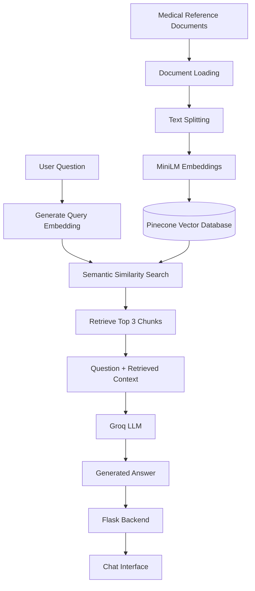

# MedRAG-AI 🩺
### AI-Powered Medical Question Answering System Using Retrieval-Augmented Generation (RAG)

MedRAG-AI is an AI-powered medical question-answering application that uses **Retrieval-Augmented Generation (RAG)** to provide context-aware answers from medical reference documents.

The application retrieves relevant information from a medical knowledge base using semantic search and passes the retrieved context to a Large Language Model (LLM) to generate relevant answers.

Unlike a basic chatbot that relies only on an LLM's pre-trained knowledge, MedRAG-AI grounds its responses in retrieved medical documents to help reduce unsupported answers.

---

## 🚀 Key Features

- **Retrieval-Augmented Generation (RAG):** Retrieves relevant medical information before generating answers.
- **Semantic Search:** Uses Hugging Face MiniLM embeddings to understand the meaning of user queries.
- **Vector Database:** Stores and retrieves document embeddings using Pinecone.
- **LLM Integration:** Uses Groq API to generate context-aware responses.
- **Document Processing:** Loads, splits, and indexes medical reference documents.
- **Context-Grounded Responses:** Instructs the LLM to answer using retrieved context and acknowledge when information is unavailable.
- **Interactive Chat Interface:** Provides a web-based interface for asking medical questions.

## 🛠️ Technology Stack

| Category | Technologies |
|---|---|
| Programming Language | Python |
| Backend | Flask |
| RAG Framework | LangChain |
| Embedding Model | Hugging Face MiniLM |
| Vector Database | Pinecone |
| LLM API | Groq API |
| Frontend | HTML, CSS, JavaScript |
| Development Tools | VS Code, Jupyter Notebook |

## 🏗️ System Architecture

MedRAG-AI follows a Retrieval-Augmented Generation architecture consisting of two major processes.

### 1. Document Indexing Pipeline

- Load medical reference documents.
- Split documents into smaller text chunks.
- Generate 384-dimensional embeddings using MiniLM.
- Store the generated embeddings in Pinecone.

### 2. Question Answering Pipeline

- The user submits a medical question through the chat interface.
- The question is converted into an embedding using the same embedding model.
- Pinecone performs semantic similarity search to retrieve the **top 3 relevant document chunks**.
- Retrieved context and the user's question are passed to the Groq-powered LLM.
- The LLM generates a context-aware response.
- Flask returns the response to the frontend.

### RAG Workflow



## 📂 Project Structure

```text
MedRAG-AI/
│
├── data/                   # Medical reference documents
│
├── research/               # Research notebooks and experiments
│   └── trials.ipynb
│
├── src/                    # Supporting application modules
│
├── static/                 # CSS, JavaScript and static assets
│
├── templates/              # HTML templates
│
├── app.py                  # Flask application entry point
├── store_index.py          # Vector indexing functionality
├── setup.py                # Project setup configuration
├── requirements.txt        # Python dependencies
├── .gitignore              # Files excluded from Git
├── .env                    # Environment variables (not committed)
├── README.md               # Project documentation
└── LICENSE                 # Apache 2.0 License
```

## ⚙️ Installation and Setup

Follow these steps to run MedRAG-AI locally.

### 1. Clone the repository

```bash
git clone https://github.com/kushalrajmondal/MedRAG-AI.git
```

### 2. Navigate to the project directory

```bash
cd MedRAG-AI
```

### 3. Create a virtual environment

```bash
python -m venv venv
```

Activate it on Windows:

```bash
venv\Scripts\activate
```

Activate it on macOS/Linux:

```bash
source venv/bin/activate
```

### 4. Install dependencies

```bash
pip install -r requirements.txt
```

### 5. Configure environment variables

Create a `.env` file in the root directory and add your API credentials.

Example:

```env
GROQ_API_KEY=your_groq_api_key
PINECONE_API_KEY=your_pinecone_api_key
```

**Note:** Use the exact environment variable names referenced in your application code. Never commit your actual `.env` file or expose API credentials publicly.

You can obtain API credentials from:

- [Groq Console](https://console.groq.com/)
- [Pinecone](https://www.pinecone.io/)

### 6. Configure the vector database

Ensure that your Pinecone index is created with the embedding dimension of **384**, matching the MiniLM embedding model.

Make sure the medical reference documents have been processed and indexed before querying the application. Refer to `store_index.py` for the indexing implementation.

### 7. Run the application

```bash
python app.py
```

Open your browser and navigate to:

```text
http://127.0.0.1:5000/
```

## 🔒 Safety and Reliability

- Uses retrieved medical reference material to ground generated responses.
- Uses a low-temperature generation configuration to encourage consistent responses.
- Includes prompt instructions to avoid inventing medical information.
- Instructs the model to acknowledge when relevant information is not available in the retrieved context.

**Medical Disclaimer:** MedRAG-AI is an educational and informational project. It is not a substitute for professional medical advice, diagnosis, or treatment. Always consult a qualified healthcare professional for medical concerns.

## 🔮 Future Improvements

- Implement conversational memory to maintain chat context.
- Add source citations and document page references.
- Introduce retrieval relevance checks to filter irrelevant results.
- Integrate a larger and more frequently updated medical knowledge base.
- Implement RAG evaluation using retrieval and answer-quality metrics.
- Add automated testing and improved error handling.

## 👨‍💻 Author

**Kushal Raj Mondal**

Master of Computer Applications (MCA)  
National Institute of Technology, Patna

GitHub: [@kushalrajmondal](https://github.com/kushalrajmondal)

## 📄 License

This project is licensed under the Apache License 2.0. See the [LICENSE](LICENSE) file for details.

---

⭐ If you find this project interesting, consider giving the repository a star!